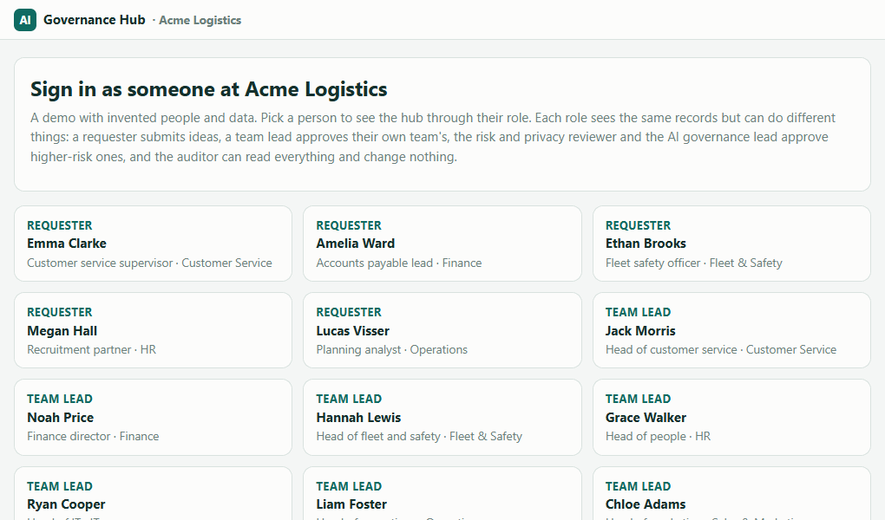
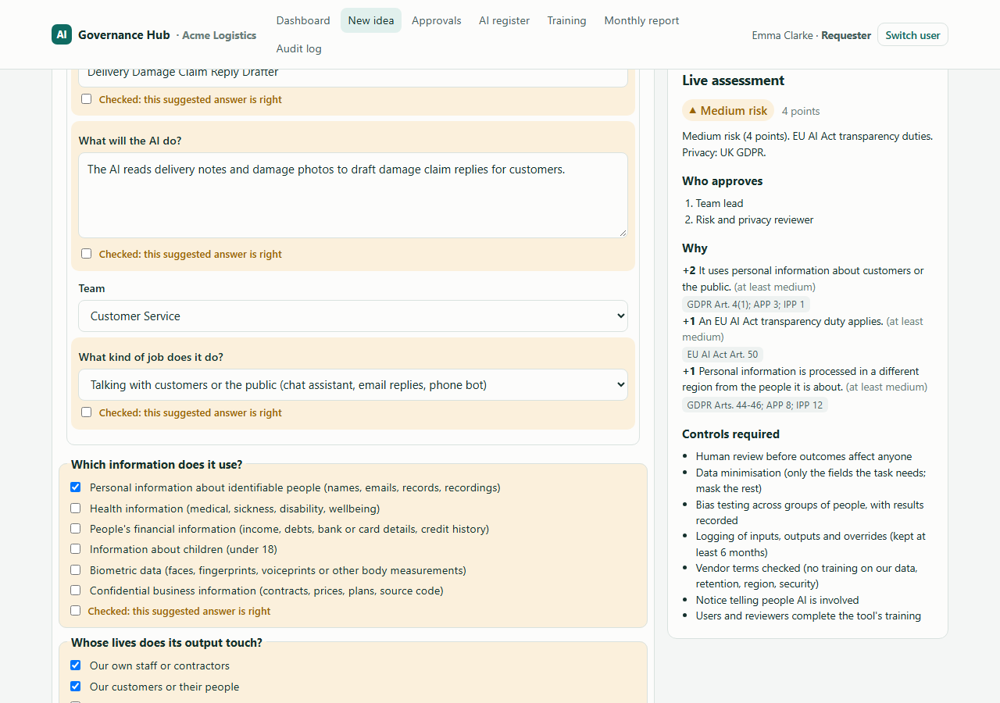
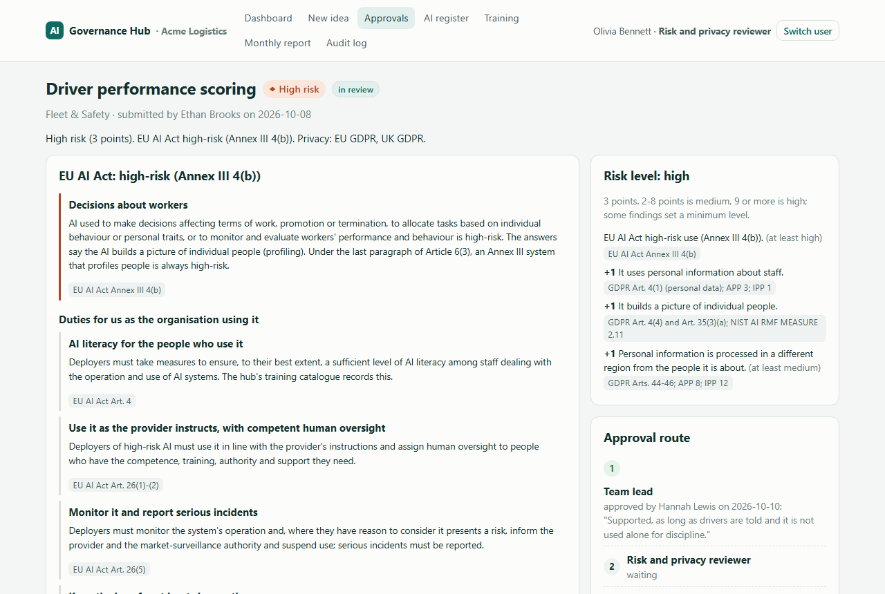
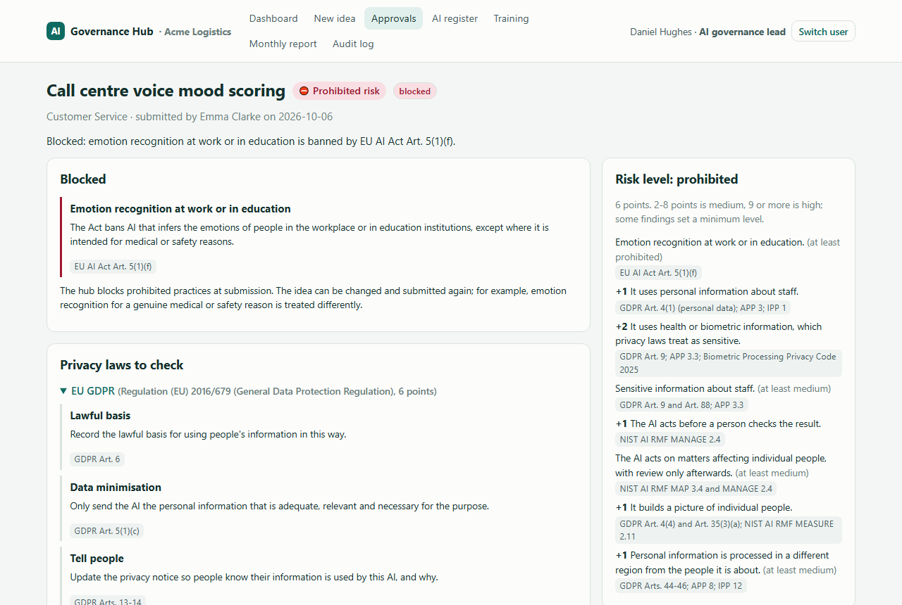
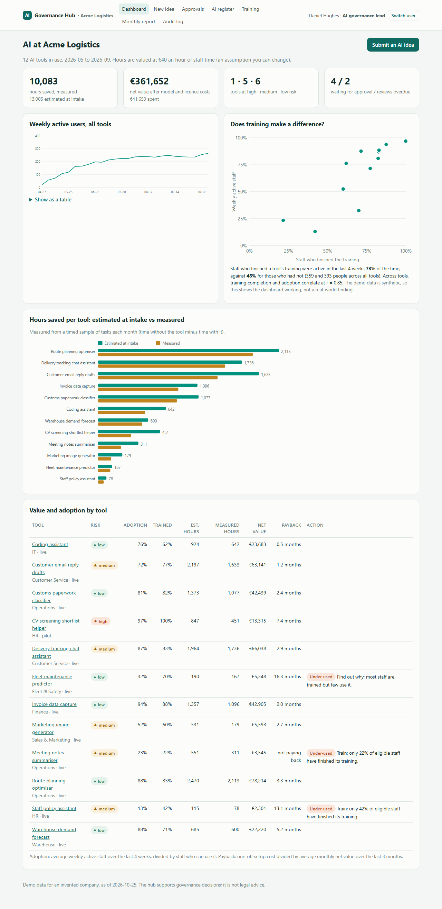
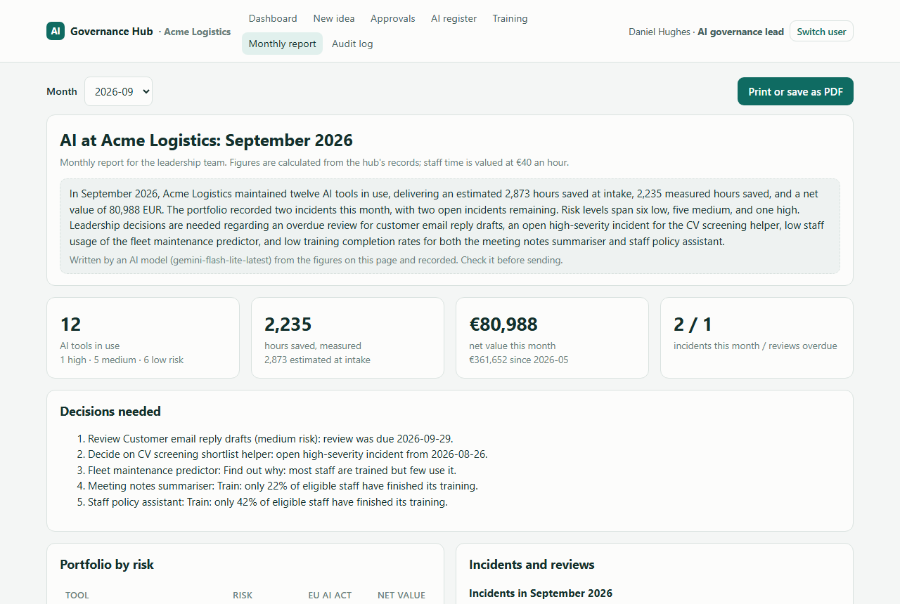
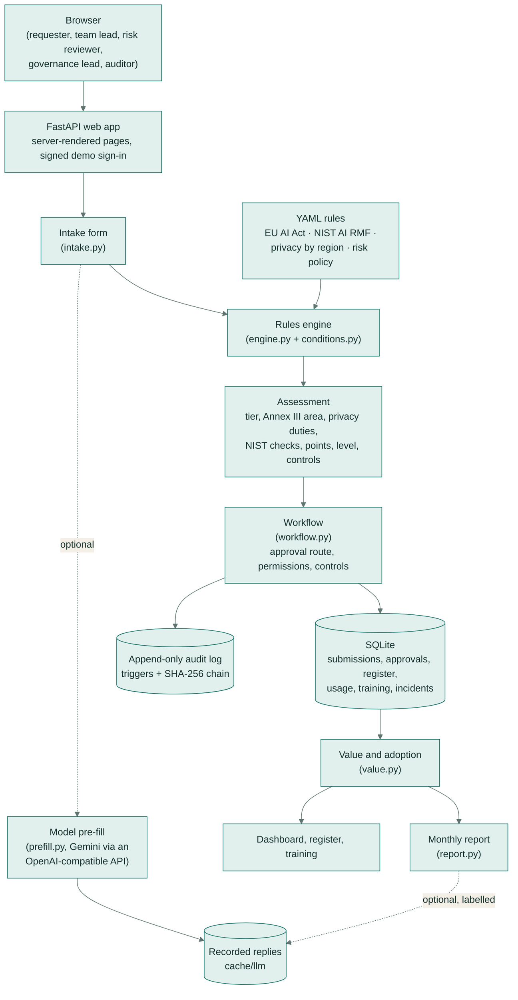
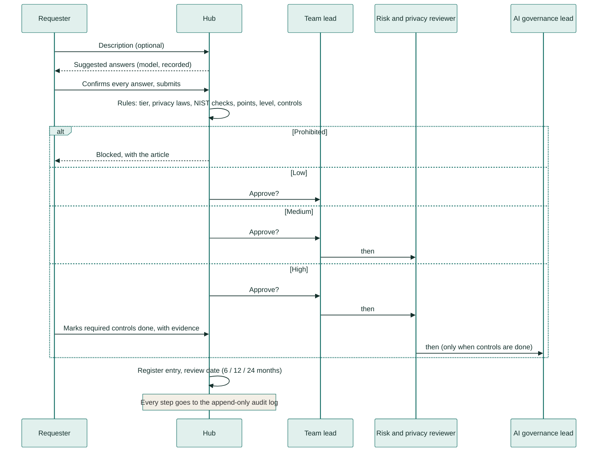

# ai-governance-hub

**A company's front door for AI.** Staff submit an idea for using AI; the hub works out how risky it is and why,
sends it to the right people for approval, keeps a register of every AI tool in use, and tracks whether each one
is used, what it saves, what it costs and what has gone wrong, with a one-page monthly report for leadership.

[](https://github.com/samiulhuda360/ai-governance-hub/actions/workflows/ci.yml)


> The hub supports governance decisions. It is not legal advice: a qualified person should confirm any finding
> that matters.

## What it does

Most companies now have dozens of people who want to use AI, and nobody who can say which ideas are safe, who
should sign them off, or whether the tools already bought are paying for themselves. This hub gives every idea
the same short form, explains in plain words which rules apply and why (with the exact article or principle),
routes it to the right approvers, and then keeps watching each approved tool: who uses it, how much time it
really saves, what it costs, and what incidents it has had.

## A real-life example

**Daniel is the AI governance lead at Acme Logistics**, a 400-person delivery company with offices in Rotterdam
and Manchester (an invented company; all its data in this repository is made up).

- **Before:** requests to use AI arrive by email and chat. Daniel reads each one, looks up the EU AI Act and two
  sets of privacy rules, and forwards it to whoever he thinks should approve it. Approvals live in email threads.
  Once a tool is live, nobody knows whether people use it or whether the hours it promised were real. Each month
  he spends most of a day pulling numbers from spreadsheets for the leadership meeting.
- **With the hub:** Emma in customer service describes her idea in a few sentences. An AI model suggests the form
  answers; she corrects two and confirms the rest. The hub rates it medium risk, names the privacy laws to check,
  and sends it to her team lead and then to the risk and privacy reviewer. When Ethan in fleet safety proposes
  scoring drivers from truck data, the hub flags it as high-risk under the EU AI Act (decisions about workers) and
  will not let it through until the required checks are done. A request to read call-centre staff's mood from
  their voices is blocked on the spot, with the article that bans it.
- **After:** every idea is triaged the moment it is submitted, with the reasons written down. Leadership gets the
  monthly report in one click: 12 tools, 2,235 hours saved in September (measured, against 2,873 promised), €80,988
  net value, one overdue review, an open bias incident, and three under-used tools with a suggested fix for each.

## How you would use it

1. Open the hub and sign in (the demo has a "sign in as" button for each role, so no passwords are needed).
2. Click **New idea**. Either fill in the short form, or paste a description and click **Suggest answers**.
3. Check each suggested answer, fix anything wrong, and tick **Checked** next to it. The panel on the right shows
   the risk level, the reasons and who will approve it, and it updates as you change the answers.
4. Click **Submit for approval**. The approvers see it under **Approvals**, with every finding and its source.
5. For a high-risk idea, tick off the required checks (for example a privacy impact assessment and bias testing)
   with a note of what was done. The final approver cannot approve until they are all done.
6. Once approved, the tool appears in the **AI register** with its next review date. The **Dashboard** shows
   usage, hours saved and value; **Training** shows who has finished each tool's short guides.
7. At month end, open **Monthly report** and click **Print or save as PDF**.


*A recorded session. Emma clicks "Use an example" and "Suggest answers". The model missed that customers are in
the Netherlands and ticked two yes/no answers that do not apply, so she fixes those before ticking "Checked" on
each suggestion. The hub rates the idea medium risk and routes it to her team lead, Jack, who approves step 1.*


*Suggested answers are highlighted and must each be confirmed. The right-hand panel is the live assessment: risk
level, points and reasons with their sources, who approves, and the controls required.*


*Scoring drivers from telematics is high-risk under the EU AI Act (Annex III 4(b), decisions about workers). The
page explains why, lists the duties for Acme as the user of the system, and shows the approval route: the team
lead has approved and the risk and privacy reviewer is next.*


*Reading staff's emotions at work is banned (Article 5(1)(f)), so the hub blocks it at submission and nobody can
approve it.*


*The dashboard for leadership: hours saved (measured from timed samples, next to the estimate made at intake),
net value after costs, how many people use each tool, and the tools that need training or a decision.*


*The one-page monthly report. Every figure comes from the records; the optional summary paragraph at the top is
written by an AI model from those figures and is labelled as such.*

More screenshots: [AI register](docs/screenshots/register.png) ·
[one tool's adoption, value and incidents](docs/screenshots/tool-detail.png) ·
[training and adoption](docs/screenshots/training.png) · [audit log](docs/screenshots/audit-log.png) ·
[sign-in page](docs/screenshots/sign-in.png) · [on a phone](docs/screenshots/mobile-dashboard.png) ·
[dark mode](docs/screenshots/dark-report.png)

## Results at a glance

Measured on 65 AI use cases written in plain words, each labelled individually against the published legal texts
(details in [Evaluation](#evaluation)):

| | Rules on the form answers | Model reads the text, rules decide (no human check) |
|---|---|---|
| EU AI Act tier correct | **65 / 65 (100%)** | 90.8% |
| High-risk cases missed | **0 of 22** | **0 of 22** |
| Prohibited cases caught | 9 of 9 | 8 of 9 |
| Privacy laws: precision / recall | 100% / 100% | 96.2% / 89.5% |
| Overall risk level correct | 100% | 92.3% |
| Held-out cases only (20), tier correct | 20 / 20 | 18 / 20 |

The first column shows that, given correct answers, the rules match the hand labels, including on 20 cases
written separately and run once after the rules were frozen. The second column is the realistic test: a model
reads only the description and fills in the form. It never missed a high-risk case, but it missed one prohibited
case (rated it high-risk instead) and got the yes/no questions fully right only 37% of the time. That is why the
hub makes a person confirm every suggested answer.

---

## Architecture



## Main flow



## How it works

1. **Intake.** The form asks for the purpose, the kind of job the AI does (24 plain-words options, several of
   which are the EU AI Act's high-risk areas), the information it uses (personal, health, financial, children's,
   biometric, confidential), who is affected, how decisions are made (suggests / acts with review / fully
   automatic), the vendor and model, where data is processed and where the people and the organisation are,
   expected users and hours saved, and 17 yes/no questions that catch the Act's special cases (for example "Does
   it only do a narrow, preparatory or checking task?" or "Is it used only for a medical or safety reason?").
2. **Optional pre-fill.** A model (Gemini, temperature 0) reads a free-text description and suggests answers.
   Values the form does not allow are dropped and shown. Each suggestion is highlighted and must be ticked
   "Checked" before the server accepts the submission. The assessment itself never uses a model.
3. **EU AI Act tier.** The rules check the eight Article 5 bans first; then the Annex III areas and Article 6(1)
   product-safety cases; then the Article 6(3) exception (a narrow or preparatory task takes an Annex III system
   out of high-risk, unless it profiles people, in which case it is always high-risk); then the Article 50
   transparency duties. The edge cases written into the Act are handled explicitly: verification is not
   identification, fraud detection is not credit scoring, only life and health insurance count, credit checks on
   companies are out, and detecting fatigue is not emotion recognition (recital 18).
4. **Privacy laws by region.** A law applies when information about people is involved and either the people or
   the organisation are in that region. The hub covers EU GDPR, UK GDPR, the Australian Privacy Principles, New
   Zealand's Information Privacy Principles and a generic US state-privacy check, each with the obligations that
   the answers trigger (for example GDPR Art. 22 for fully automatic decisions about people, Art. 35 for a DPIA,
   APP 8 or IPP 12 when data leaves the country, with adequacy decisions named where they exist).
5. **NIST AI RMF checks.** Concrete checks grouped under Govern, Map, Measure and Manage, each naming its
   subcategory (for example MANAGE 2.4: "Name who can switch it off, how, and what the fallback process is"),
   with ISO/IEC 42001 cross-references.
6. **Overall risk level.** Each risk driver adds points and may set a minimum level; 2 to 8 points is medium, 9 or
   more is high; EU high-risk and prohibited set the level directly. Every point is listed with its reason and
   source, so the level can be challenged line by line.
7. **Controls.** Generated per level: human review, data minimisation, a DPIA or PIA, bias testing, logging, a kill
   switch, a vendor terms check, a notice to people, training and, where Article 27 applies, a
   fundamental-rights impact assessment.
8. **Approval.** Low: team lead. Medium: plus the risk and privacy reviewer. High: plus the AI governance lead,
   who can only approve once every required control is marked done with evidence. Approvals happen in order.
   Nobody can approve their own idea (if a team lead submits, the governance lead approves that step). The
   auditor can read everything and change nothing.
9. **Audit log.** Every action is written in the same database transaction as the change, with who, when, and the
   record before and after. Database triggers reject any update or delete, and each entry stores a SHA-256 hash
   of the previous one, so an edit made directly in the database shows up as a broken chain on the audit page.
   The log exports as CSV.
10. **Register.** Approval creates a register entry with the owner, purpose, tier, vendor, data, region, controls
    in place and the next review date (high every 6 months, medium 12, low 24). Overdue reviews are flagged.
11. **Adoption and value.** For each live tool: weekly active users against eligible staff, tasks, overrides and
    errors, model cost, and a monthly timed sample of tasks with and without the tool. Hours saved are shown both
    as estimated at intake and as measured; net value is measured hours times the staff cost per hour, minus model
    and licence costs; payback is the setup cost over the average monthly net value. Tools with under 35% weekly
    adoption are flagged, with a suggestion: train (if under half the eligible staff finished the training), find
    out why (if most are trained), or consider retiring (if it also costs more than it saves).
12. **Training.** Each tool has short guides; completions are recorded per person, and the dashboard compares
    adoption between staff who finished the training and those who did not.
13. **Monthly report.** One printable page: tools by risk, hours and value, incidents, overdue reviews, ideas
    waiting, and a numbered list of decisions needed, all from the data. An optional summary paragraph is written
    by a model from the same figures, recorded, and labelled on the page.

The demo data for Acme Logistics (12 live tools over 26 weeks, about 5,000 weekly usage records, 400 staff,
five ideas in the pipeline) is generated with a fixed random seed and pushed through the real workflow functions,
so its audit log, review dates and register come from the same code the web app uses. Usage figures are
synthetic, and so is the training effect: the dashboard is real, the correlation is built into the data.

## Evaluation

**How the set was built.** 65 AI use cases written as a member of staff would describe them, across logistics,
retail, banking, insurance, health, education, local government, HR services, manufacturing, utilities, media,
travel, charity and legal work, in the EU, UK, Australia, New Zealand and the US. Each is labelled individually against
the published texts (Article 5, Article 6, Article 50, Annex III and recital 18 of the EU AI Act, and the privacy
laws' territorial scope) with: the tier, the Annex III area if high-risk, the privacy laws that apply, the overall
risk level, and the form answers a careful person would give. The conventions are in
[eval/labelling-guide.md](eval/labelling-guide.md).

- **45 development cases** were used while writing the rules.
- **20 held-out cases** were written separately, without access to the rules, and run once after the rules were
  committed (the git history shows the rules commit before the held-out cases were added).

**What is measured.** Tier accuracy; high-risk recall (it must not miss a high-risk case); prohibited recall;
Annex III area accuracy; privacy-law precision and recall; risk-level accuracy and how often the level comes out
lower than the label. Then the same measures when a model fills in the form from the description alone, plus
field-by-field accuracy of the model's suggestions.

| Measure | Development (45) | Held-out (20) | All (65) |
|---|---|---|---|
| **Rules on the hand-filled answers** | | | |
| EU AI Act tier accuracy | 100% | 100% | 100% |
| High-risk recall (cases missed) | 100% (0) | 100% (0) | 100% (0) |
| Annex III area correct | 100% | 100% | 100% |
| Prohibited recall | 100% | 100% | 100% |
| Privacy-law precision / recall | 100% / 100% | 100% / 100% | 100% / 100% |
| Risk level accuracy | 100% | 100% | 100% |
| **Model fills the form, rules decide** | | | |
| EU AI Act tier accuracy | 91.1% | 90.0% | 90.8% |
| High-risk recall (cases missed) | 100% (0) | 100% (0) | 100% (0) |
| Prohibited recall | 100% | 66.7% | 88.9% |
| Privacy-law precision / recall | 100% / 97.3% | 88.2% / 75.0% | 96.2% / 89.5% |
| Risk level accuracy (rated lower than label) | 95.6% (0) | 85.0% (1) | 92.3% (1) |

Model suggestions against the hand-filled answers (all 65 cases): kind of job 83.1%, decision mode 83.1%,
processing region 87.7%, data categories 75.4%, who is affected 61.5%, where the people are 80.0%, where the
organisation is 92.3%; the yes/no questions were all right in 36.9% of cases (flag precision 68.9%, recall
93.7%: the model ticks too many rather than too few).

**Reading these numbers.** A perfect score for the rules means the rules agree with the labels when the form is
filled in correctly; the form's questions were designed around the distinctions the Act makes, so much of the
difficulty moves to answering them well. The model-filled column is the realistic picture of that difficulty. The
set has few Australian (3), New Zealand (2) and US (5) privacy cases compared with EU GDPR (39), so those figures
rest on little data. Full results: [eval/results.md](eval/results.md), raw: [eval/results.json](eval/results.json).

Model: `gemini-flash-lite-latest` through Google's OpenAI-compatible endpoint, temperature 0. Every reply is
recorded in `cache/llm/` keyed by the SHA-256 of the exact request, so `python eval/run_eval.py --check` replays
all 65 replies offline and fails if any number changes. 67 live calls were made in total (65 for the evaluation,
one for the demo example's pre-fill and one for the September report summary).

## Tech stack

- **Python 3.11+**, **FastAPI** and **Jinja2** server-rendered pages, a few lines of plain JavaScript for the
  live assessment panel, CSS with light and dark themes that works on a phone.
- **SQLite** (standard library) with triggers for the append-only audit log.
- **YAML** rules read by a small condition language (no code in the rules), validated by **pydantic**.
- **httpx** to an OpenAI-compatible endpoint (Gemini by default) with a record-and-replay cache, a minimum interval
  between calls and a hard cap on live calls.
- Charts are SVG drawn on the server, each with hover labels and a table view.
- **pytest**, **ruff**, **mypy --strict**, **GitHub Actions**.

The running app uses about 60 MB of memory (measured working set after loading every page with the demo data).

## Setup

```bash
python -m venv .venv && source .venv/bin/activate      # Windows: .venv\Scripts\activate
pip install -e ".[dev]"
hub seed           # builds data/hub.db with the Acme Logistics demo
hub serve          # http://127.0.0.1:8060  -> pick a person on the sign-in page
```

Everything runs with no model key: the demo example's suggestions, the evaluation and the September report
summary are replayed from `cache/llm/`. New descriptions need a key; without one, the form says so and works
by hand.

### Configuration (environment variables)

| Name | Purpose |
|---|---|
| `AI_API_KEY` | Key for the model endpoint (only needed for new pre-fills or summaries) |
| `AI_BASE_URL` | OpenAI-compatible endpoint; defaults to Google's Gemini endpoint |
| `AI_MODEL` | Model name; defaults to `gemini-flash-lite-latest` |
| `AI_MIN_INTERVAL` | Seconds between live calls |
| `AI_MAX_CALLS` | Hard cap on live calls recorded in the cache folder (default 120) |
| `HUB_OFFLINE` | `1` to never call a model (replay only) |
| `HUB_DB` | Path of the SQLite database (default `data/hub.db`) |
| `HUB_CACHE_DIR` | Folder for recorded model replies (default `cache/llm`) |
| `HUB_SECRET` | Key for signing the demo sign-in cookie (random per start if unset) |

### Other commands

```bash
hub assess examples/cv-screening.json      # assessment for one form, as text and JSON
hub report --month 2026-09 --out report.html
python eval/run_eval.py --check            # replay the evaluation offline
make check                                 # ruff, format, mypy, pytest, evaluation replay
```

The JSON endpoint `POST /api/assess` takes the same fields as the form and returns the full assessment.

The rules are plain YAML in `governance_hub/rules/`. The points, bands, controls and review intervals in
`risk.yaml` are the hub's own policy and can be changed; every legal provision used is listed in
[docs/sources.md](docs/sources.md).

## Project structure

```
governance_hub/
  intake.py        the form: fields, plain-words questions, allowed values
  conditions.py    the small condition language used by the YAML rules
  engine.py        assessment: tier, Annex III area, privacy duties, NIST checks, points, level, controls
  rules/           eu_ai_act.yaml, nist_rmf.yaml, privacy.yaml, risk.yaml
  workflow.py      submission, approval route, permissions, controls, register, reviews, incidents
  db.py            SQLite schema, append-only hash-chained audit log, CSV export
  value.py         adoption, estimated vs measured hours, net value, payback, training effect
  report.py        monthly leadership report (optional recorded model summary)
  prefill.py       optional model pre-fill with validation of every value
  llm.py           OpenAI-compatible client with record/replay cache, rate limit and call cap
  seed.py          Acme Logistics demo data, pushed through the real workflow
  charts.py        server-side SVG charts
  web.py, templates/, static/   the web app
  cli.py           hub seed | serve | assess | report
eval/              labelled cases (dev and held-out), labelling guide, runner, results
cache/llm/         recorded model replies (replayed offline)
docs/              sources.md, screenshots, demo.gif
examples/          a sample intake form
tests/             pytest suite
```

## Tests

72 tests, run offline in CI on Python 3.11, 3.12 and 3.13:

- **Rules engine:** each Article 5 ban; Annex III areas and their exclusions; the Article 6(3) exception and the
  profiling override; Article 6(1); transparency duties; privacy laws by region and transfers; levels, floors and
  controls; every finding carries a source; every condition in every rules file uses a known key.
- **Permissions:** nobody approves their own idea; only the requester's own team lead; steps cannot be skipped;
  high risk needs every required control with evidence; prohibited ideas have no route; rejection stops the
  route; the auditor cannot change anything (and the audit log does not grow when they try).
- **Audit log:** time order, updates and deletes rejected, tampering detected by the hash chain, before and after
  recorded, CSV export.
- **ROI arithmetic:** a small database where every figure can be worked out by hand (hours, value, cost, net,
  payback, adoption, training effect, correlation).
- **Report and web:** report figures and decisions, recorded and missing summaries, every page renders, a forged
  sign-in cookie is refused, suggested answers must each be confirmed, unknown teams are rejected.
- **Evaluation replay:** `eval/run_eval.py --check` reruns all 65 cases from the recorded replies.

## Licence

MIT. See [LICENSE](LICENSE).
